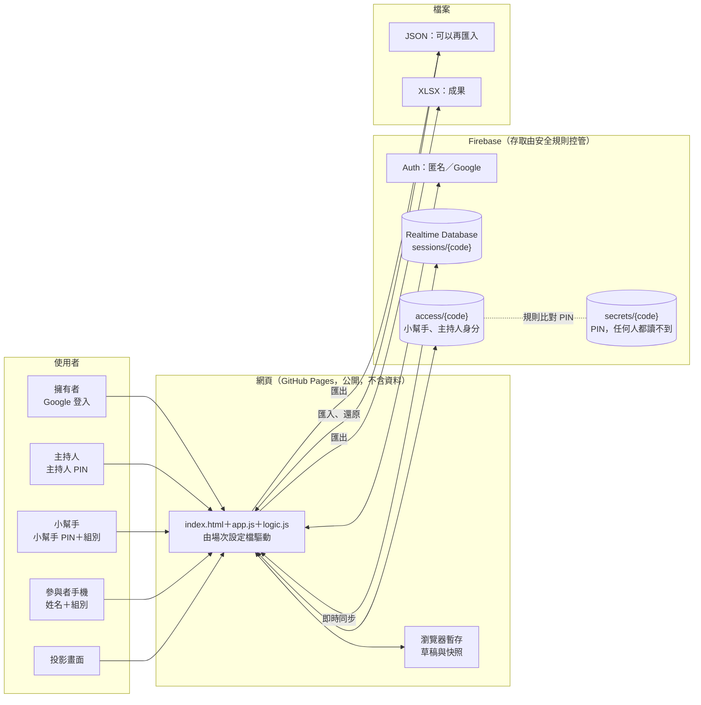

# 關注點共編投票工具｜規格 v1.0（2026/11/19，規格凍結）

> 專案代號：`concern-board`
> 首次使用：3.成案期決策演練工作坊（12/11）14:25～15:17
> 文件分兩部分：**Part A 使用說明**（主持人、小幫手、參與者、擁有者）／**Part B 開發交接**（Claude Code、未來的維護者）
> 決策紀錄 T1～T25 不得自行重新詮釋；要修改時，先改決策紀錄，再改規格與程式。
> 修訂：2026/11/20 B5 安全規則定稿（5 項差異見 B5，經 Mike 同意；決策紀錄未變更）
> 修訂：2026/11/20 新增決策 T23（不同分類不能合併）、T24（分拆）、T25（合併後的已改寫），經 Mike 同意；對應 A6、B6、B8（G10～G13）、B9

---

# Part A｜使用說明

## A1. 這個工具做什麼

讓各組把**小組關注點**輸入同一個地方，休息時合併相似的題目，成為全體的**建議關注點**；再用手機分段投票，標出**優先聚焦**的題目。所有畫面即時同步，主持人統一投影。

## A2. 系統簡圖



| 輸入 | 系統 | 輸出 |
|---|---|---|
| 題目、合併（小幫手）<br>階段與投票開關（主持人）<br>選票（參與者）<br>JSON 匯入、可見性、PIN（擁有者） | 網頁（流程引擎＋畫面）↔ Firebase（資料＋規則） | 投影畫面（依組別、依分類、結果並排）<br>JSON（可以再匯入）<br>XLSX（成果） |

## A3. 角色與進入方式

| 角色 | 怎麼進入 | 能做什麼 |
|---|---|---|
| 擁有者 | `#/admin`，用 Google 登入（只限擁有者帳號） | 建立、刪除場次；切換可見性；設定 PIN；匯出與匯入 |
| 主持人 | 掃描或輸入場次代碼 → 選「主持人」→ 輸入主持人 PIN | 切換階段、開關投票、公布結果、匯出 |
| 小幫手 | 場次代碼 → 選「小幫手」→ 輸入小幫手 PIN → 選組別 | 輸入、修改、合併、拆回題目 |
| 參與者 | 掃投影畫面上的 QR code → 輸入姓名、選組別 | 投票 |
| 投影 | 主持人在自己的畫面按「開啟投影畫面」 | 依階段自動顯示 |

## A4. 場次可見性

| 可見性 | 誰能讀 | 誰能寫 | 什麼時候用 |
|---|---|---|---|
| 🔒 私人（預設） | 只有擁有者 | 只有擁有者 | 平常保存、會後閱讀、匯入後 |
| 🟢 進行中 | 知道場次代碼的人 | 小幫手、主持人依階段寫入；參與者只能投票 | 工作坊當天 |
| 👁 展示 | 知道場次代碼的人 | 沒有人 | 對外 demo |

網站本身是公開的，但不含任何資料；私人場次就算別人知道代碼也讀不到。想讓網站完全下線，可以到 GitHub repo 的設定關閉 Pages。

## A5. 當天流程（成案期工作坊模板）

| 階段 | 時間 | 小幫手 | 參與者手機 | 投影畫面 |
|---|---|---|---|---|
| ① 收集 | 14:25 | 輸入本組 2～3 個小組關注點：題目、分類，以及有沒有改寫 | 等待畫面 | 依組別 |
| ② 合併 | 14:40 | 合併相似的題目（可以跨組），必要時拆回 | 等待畫面 | 全部（依分類） |
| ③ 分享 | 14:55 | 不能編輯 | 等待畫面 | 依組別，主持人逐組切換 |
| ④ 投票：實質影響 | 15:07 | 不能編輯 | 選 1～3 題送出，可以改票 | 題目＋已投票人數（不顯示票數） |
| ⑤ 投票：成本 | 15:11 | 不能編輯 | 同上 | 同上 |
| ⑥ 結果 | 15:15 | 不能編輯 | 「感謝參與」 | 兩類並排：名次、占比／票數，優先聚焦項目加上標示 |

主持人可以退回上一個階段。某一類沒有題目時，自動跳過該類的投票階段。

## A6. 操作要點

**小幫手**
- 不需要按「儲存」：停止輸入 0.5 秒就會自動寫入。右上角的燈號顯示連線狀態：● 已同步、● 離線，恢復後自動同步。
- **合併**：勾選 2 題以上 → 按「合併」→ 選用其中一題的文字或自己改寫 → 產生新題目，組別自動合併標示（例如「第 1、3 組」）。原題會隱藏起來，但不會被刪除。
  - 只有同一分類的題目能合併（T23）。分類寫錯時，先把它改成正確的分類，再合併。
  - 合併後的題目會自動判斷「已改寫」（T25），之後仍可以手動修改。
- **分拆**：一題的內容橫跨兩類時，按題目旁的「分拆」→ 複製出一題（組別相同、分類預設另一類、標示已改寫）→ 再把兩題分別改寫（T24）。收集階段只能分拆本組的題目，合併階段可以分拆所有組。
- **拆回**：合併後的題目旁邊有「拆回」按鈕，按下後恢復成原本的幾題。
- **刪除**合併後的題目時，會詢問「拆回」（預設）或「連同原題一起刪除」。
- 題目上限 150 字。

**參與者**
- 姓名和組別都必填，顯示成「Mike（第 2 組）」。同一組已經有人用同一個名字時，畫面會請你加一個註記，例如「Mike-RD」。
- 每一段最多選 3 題（題數少於 3 時，最多等於題數），不必投滿。投票期間可以改票，以最後送出的為準。

**主持人**
- 畫面上會顯示各類的投票人數和同名警示。
- 結果畫面上，「優先聚焦」＝名次在前 3 名而且至少 1 票；同票的同名次（例如 1、2、2、2、5），所以優先聚焦可能超過 3 題。
- 占比＝該題票數 ÷ 該類總票數，取整數 %。四捨五入後，加總可能是 99% 或 101%。

## A7. 擁有者操作

| 想做的事 | 步驟 |
|---|---|
| 開新場次 | `#/admin` → 「新場次」→ 選模板（或「用某場次的設定開新場次」）→ 系統產生 6 碼場次代碼 → 設定小幫手和主持人 PIN（各 6 位數字）→ 當天把可見性切到「進行中」 |
| 會後保存 | 匯出 JSON 和 XLSX → 把可見性切回「私人」→ JSON 另存到 Project 或 Confluence |
| 對外 demo | 可見性切到「展示」（唯讀），把連結給對方；結束後切回「私人」 |
| 刪除場次 | 「刪除」→ 系統先自動匯出 JSON → 再確認一次才刪除 |
| 還原場次 | 「匯入 JSON」→ 選擇代碼（沿用原代碼或產生新代碼）→ 匯入後可見性為「私人」→ 需要的話重新設定 PIN（PIN 不會匯出） |
| 改成其他活動 | 匯出某個場次的設定檔 → 修改分類、階段、投票規則 → 用新的設定檔開新場次（圖形化的設定編輯器在 v1.x） |

## A8. 常見問題

| 問題 | 回答 |
|---|---|
| 投票時有人換手機，或用無痕視窗再投一次？ | 會被當成新的投票者（信任制）。主持人畫面的同名警示可以協助察覺 |
| 網路斷了怎麼辦？ | 繼續操作即可：變更會先存在本機，恢復連線後自動送出。斷線中重新整理頁面，也會從瀏覽器的暫存還原 |
| 投票期間懂技術的人看得到即時票數嗎？ | 可以從資料庫讀到。隱藏只做在畫面上，內部工作坊可以接受 |
| 同時能有多少人連線？ | 免費版上限 100 個連線，每個瀏覽器分頁算一個。本場預估約 40 |
| 刪除 Firebase 專案會怎樣？ | 所有場次一起消失，只剩匯出的 JSON |

## A9. 紙本備案
網路或工具出問題時：主持人匯出（或事先列印）題目清單 → 各組改用便條紙 → 投票改用圓點貼。主持人畫面提供「列印題目清單」。

---

# Part B｜開發交接

## B1. 決策紀錄（不得自行重新詮釋）

| 編號 | 決策 |
|---|---|
| T1 | 匯出：JSON（可以再匯入）＋XLSX（方便閱讀） |
| T2 | 收集階段，小幫手只能編輯本組；合併階段可以編輯所有組 |
| T3 | 投票者：姓名＋組別都必填；同組又同名時，後進入者被要求加註記；不收員工編號 |
| T4 | 投票期間可以改票，後送出的覆蓋前一次 |
| T5 | 0 票的項目不算優先聚焦 |
| T6 | 占比取整數 %（四捨五入） |
| T7 | 結果只在投影畫面顯示，手機不顯示 |
| T8 | 投票期間鎖住所有項目編輯 |
| T9 | 項目有「已改寫」欄位（boolean） |
| T10 | 組數可以設定，預設 5、最多 8；不能小於已使用的最大組號 |
| T11 | 介面用繁體中文 |
| T12 | 可見性：private（預設）／live／demo，由安全規則在伺服器端檢查 |
| T13 | 擁有者只能用 Google 登入，且只限一個帳號；主持人和小幫手用 PIN |
| T14 | 流程由場次設定檔驅動；初版只內建 `prmc-workshop` 一套設定；設定編輯器放到 v1.x |
| T15 | 即時存檔：停止輸入 0.5 秒自動寫入；Firebase 離線佇列；localStorage 另存草稿與快照，重新整理後還原 |
| T16 | 投影畫面顯示 QR code，掃描後直接進入場次 |
| T17 | 網站本身維持公開，不含資料 |
| T18 | 題目上限 150 字，必填，前後空白去除 |
| T19 | PIN 是 6 位數字；擁有者可以隨時更換 |
| T20 | 刪除合併後的項目時，預設拆回；另外提供「連同來源一起刪除」 |
| T21 | QR code 套件直接內嵌，不使用 CDN |
| T22 | 擁有者的 UID 寫死在 `database.rules.json`，不放在資料庫 |
| T23 | 不同分類的項目不能合併；分類寫錯時，先改分類（收集階段改本組、合併階段改所有組）再合併（2026/11/20 Mike 決定） |
| T24 | 分拆：複製出一個新項目，組別與原項目相同、分類預設為另一類（3 類以上時為設定檔中下一類）、`rewritten`＝true、文字先沿用原項目；不記錄來源關係，不能「拆回」。收集階段限本組，合併階段可以分拆所有組，其他階段不行（2026/11/20 Mike 決定） |
| T25 | 合併後項目的 `rewritten`：任一來源已改寫，或合併後的文字和每一個來源都不同時為 true，否則 false；之後可以手動修改（2026/11/20 Mike 決定） |
| R1 | 每段每人最多 `min(vote.maxPerVoter, 該類 active 題數)` 票；一題最多一票；可以不投滿 |
| R2 | 占比＝該題票數 ÷ 該類總票數；總票數是 0 時顯示「—」 |
| R3 | 名次採 competition ranking：同票同名次，下一名跳號（1, 2, 2, 4） |
| R4 | 優先聚焦＝名次 ≤ `priorityTopN`，而且票數 ≥ `priorityMinVotes` |
| R5 | 兩類各自排名、並排顯示，不跨類合併排名 |
| R6 | 合併後的組別＝來源組別的聯集；來源改為 `merged`，記錄 `mergedInto`；拆回只拆一層 |

## B2. 技術架構與不可違反的規則

| 項目 | 規定 |
|---|---|
| 前端 | 靜態檔案：`index.html`＋`app.js`（畫面、Firebase）＋`logic.js`（純函式，不碰 DOM 也不碰 Firebase，可以單獨測試）；**不需要 build** |
| 套件 | Firebase JS SDK 用 modular 版，從 gstatic **固定 10.12.0**；SheetJS 從 cdn.sheetjs.com **固定 0.20.3**；QR code 套件內嵌（T21） |
| 資料庫 | Firebase Realtime Database（Spark 免費版） |
| 身分 | Firebase Auth：參與者、小幫手、主持人用匿名登入；擁有者用 Google 登入 |
| 發布 | GitHub Pages（公開 repo，main 分支根目錄）；安全規則用 `firebase deploy --only database` 部署 |
| 不可違反 | ① 業務規則（R1～R6）只能實作在 `logic.js`，畫面只呼叫它；② PIN 不能出現在任何能被讀到的路徑；③ 不在 localStorage 存 PIN；④ 不新增其他外部網域；⑤ JSON 匯出不包含 `secrets` 和 `access` |

## B3. 資料契約（Realtime Database）

```
/sessions/{code}
  meta:
    title: string
    visibility: "private" | "live" | "demo"
    templateId: string            # 例如 "prmc-workshop"
    schemaVersion: 1
    config: { ...場次設定檔，見 B4... }
    phase: { index: number, type: "collect"|"merge"|"share"|"vote"|"results", category?: string }
    groupCount: number            # 1..8
    createdAt, updatedAt: serverTimestamp
  items/{itemId}:
    text: string (1..150)
    cat: string                   # config.categories[].key
    groups: { "1": true, "3": true }
    rewritten: boolean
    status: "active" | "merged"
    mergedInto?: itemId           # 只有 status=merged 時才有
    sources?: { itemId: true }    # 合併產生的項目才有
    createdBy: uid, createdGroup: number
    createdAt, updatedAt: serverTimestamp, updatedBy: uid
  votes/{cat}/{uid}:
    name: string, group: number
    v1?: itemId, v2?: itemId, v3?: itemId     # 最多 3 個，不能重複
    ts: serverTimestamp
  participants/{uid}:
    name: string, group: number, joinedAt: serverTimestamp

/access/{code}/helpers/{uid}: { pin: string, group: number }   # 只有本人和擁有者能讀
/access/{code}/hosts/{uid}:   { pin: string }
/secrets/{code}: { helperPin: string, hostPin: string }        # 讀取一律禁止；只有擁有者能寫
```

## B4. 場次設定檔（`config/templates/prmc-workshop.json`）

```json
{
  "templateId": "prmc-workshop",
  "title": "成案期決策演練工作坊",
  "categories": [
    {"key": "impact", "label": "實質影響", "color": "#F5C518", "textColor": "#1b2430"},
    {"key": "cost",   "label": "成本",     "color": "#3B82F6", "textColor": "#ffffff"}
  ],
  "groups": {"count": 5, "max": 8},
  "labels": {"item": "小組關注點", "collection": "建議關注點", "priority": "優先聚焦"},
  "itemFields": {"rewritten": true, "maxLength": 150},
  "voter": {"fields": ["name", "group"]},
  "phases": [
    {"type": "collect", "label": "收集小組關注點"},
    {"type": "merge",   "label": "協力統整"},
    {"type": "share",   "label": "大組分享共創的建議關注點"},
    {"type": "vote", "category": "impact", "label": "優先聚焦投票：實質影響"},
    {"type": "vote", "category": "cost",   "label": "優先聚焦投票：成本"},
    {"type": "results", "label": "優先聚焦結果"}
  ],
  "vote": {"maxPerVoter": 3, "rank": "competition", "priorityTopN": 3,
           "priorityMinVotes": 1, "hideUntilClose": true, "showOnPhone": false,
           "question": "下一次 Pre-talk，你最想先問哪一題？"}
}
```
驗證規則：分類的 key 不能重複；`phases` 裡的 category 必須存在；`groups.count` 介於 1～`max`，且 max ≤ 8；`maxPerVoter` 介於 1～10。驗證失敗時拒絕匯入，並列出所有錯誤。

## B5. 安全規則（v0.1 定稿，2026/11/20 經 Mike 同意）

```json
{
  "rules": {
    "sessions": {
      ".read": "auth != null && auth.uid === 'OWNER_UID'",
      "$code": {
        ".read": "auth != null && (auth.uid === 'OWNER_UID' || data.child('meta/visibility').val() === 'live' || data.child('meta/visibility').val() === 'demo')",
        ".write": "auth != null && auth.uid === 'OWNER_UID'",
        "meta": {
          ".write": "auth != null && auth.uid === 'OWNER_UID'",
          "visibility": { ".validate": "newData.val() === 'private' || newData.val() === 'live' || newData.val() === 'demo'" },
          "groupCount": { ".validate": "newData.isNumber() && newData.val() >= 1 && newData.val() <= 8" },
          "phase": {
            ".write": "auth != null && (auth.uid === 'OWNER_UID' || (root.child('sessions/'+$code+'/meta/visibility').val() === 'live' && root.child('secrets/'+$code+'/hostPin').exists() && root.child('access/'+$code+'/hosts/'+auth.uid+'/pin').val() === root.child('secrets/'+$code+'/hostPin').val()))"
          }
        },
        "items": {
          "$id": {
            ".write": "auth != null && (auth.uid === 'OWNER_UID' || (root.child('sessions/'+$code+'/meta/visibility').val() === 'live' && root.child('secrets/'+$code+'/helperPin').exists() && root.child('access/'+$code+'/helpers/'+auth.uid+'/pin').val() === root.child('secrets/'+$code+'/helperPin').val() && (root.child('sessions/'+$code+'/meta/phase/type').val() === 'merge' || (root.child('sessions/'+$code+'/meta/phase/type').val() === 'collect' && (!data.exists() || data.child('groups/'+root.child('access/'+$code+'/helpers/'+auth.uid+'/group').val()).exists()) && (!newData.exists() || newData.child('groups/'+root.child('access/'+$code+'/helpers/'+auth.uid+'/group').val()).exists())))))",
            "text": { ".validate": "newData.isString() && newData.val().length >= 1 && newData.val().length <= 150" }
          }
        },
        "votes": {
          "$cat": {
            "$uid": {
              ".write": "auth != null && auth.uid === $uid && root.child('sessions/'+$code+'/meta/visibility').val() === 'live' && root.child('sessions/'+$code+'/meta/phase/type').val() === 'vote' && root.child('sessions/'+$code+'/meta/phase/category').val() === $cat",
              ".validate": "newData.hasChildren(['name','group','ts'])",
              "v1": { ".validate": "auth.uid === 'OWNER_UID' || (root.child('sessions/'+$code+'/items/'+newData.val()+'/status').val() === 'active' && root.child('sessions/'+$code+'/items/'+newData.val()+'/cat').val() === $cat)" },
              "v2": { ".validate": "auth.uid === 'OWNER_UID' || (newData.val() !== newData.parent().child('v1').val() && root.child('sessions/'+$code+'/items/'+newData.val()+'/status').val() === 'active' && root.child('sessions/'+$code+'/items/'+newData.val()+'/cat').val() === $cat)" },
              "v3": { ".validate": "auth.uid === 'OWNER_UID' || (newData.val() !== newData.parent().child('v1').val() && newData.val() !== newData.parent().child('v2').val() && root.child('sessions/'+$code+'/items/'+newData.val()+'/status').val() === 'active' && root.child('sessions/'+$code+'/items/'+newData.val()+'/cat').val() === $cat)" },
              "name":  { ".validate": "newData.isString() && newData.val().length >= 1 && newData.val().length <= 30" },
              "group": { ".validate": "newData.isNumber()" },
              "ts":    { ".validate": "auth.uid === 'OWNER_UID' || newData.val() === now" },
              "$other": { ".validate": false }
            }
          }
        },
        "participants": {
          "$uid": {
            ".write": "auth != null && auth.uid === $uid && root.child('sessions/'+$code+'/meta/visibility').val() === 'live'"
          }
        }
      }
    },
    "access": {
      "$code": {
        ".write": "auth != null && auth.uid === 'OWNER_UID'",
        "helpers": { "$uid": {
          ".read": "auth != null && (auth.uid === $uid || auth.uid === 'OWNER_UID')",
          ".write": "auth != null && (auth.uid === 'OWNER_UID' || (auth.uid === $uid && root.child('secrets/'+$code+'/helperPin').exists() && newData.child('pin').val() === root.child('secrets/'+$code+'/helperPin').val()))"
        }},
        "hosts": { "$uid": {
          ".read": "auth != null && (auth.uid === $uid || auth.uid === 'OWNER_UID')",
          ".write": "auth != null && (auth.uid === 'OWNER_UID' || (auth.uid === $uid && root.child('secrets/'+$code+'/hostPin').exists() && newData.child('pin').val() === root.child('secrets/'+$code+'/hostPin').val()))"
        }}
      }
    },
    "secrets": {
      "$code": { ".read": false, ".write": "auth != null && auth.uid === 'OWNER_UID'" }
    }
  }
}
```
- `OWNER_UID` 在設定步驟 4 換成擁有者的 UID（T22）。
- 已知的限制：「每段最多 min(3, n) 票」的 n 由前端檢查，規則只限制最多 3 票（v1～v3）。
- 正確的 PIN 只會被寫在本人的 `access/{code}/...` 下，而這個路徑只有本人和擁有者能讀；`secrets` 一律不能讀取。
- 正本是 `database.rules.json`；這裡的內容和它相同（只有 UID 換成 `OWNER_UID`）。已用 Firebase emulator 加上 `@firebase/rules-unit-testing` 驗證 B8 的全部權限案例（`tests/rules.test.js`）。
- **和原草案的差異（2026/11/20 經 Mike 同意）**：草案以工作坊當天的角色為主，emulator 測試發現擁有者的管理流程有缺口，另有一個 PIN 漏洞。決策紀錄 T1～T22、R1～R6 都沒有變更。
  1. `sessions` 加上「只有擁有者可以讀整個清單」：草案只開放讀單一場次，`#/admin` 列不出場次。
  2. `sessions/$code`、`access/$code` 加上「擁有者可以整筆寫入、刪除」：建立、匯入場次是一次寫入整個場次（含 `votes`、`participants`），草案只讓擁有者寫 `meta` 和單題 `items`，整筆會被拒絕。
  3. 選票的 `v1`～`v3`、`ts` 驗證對擁有者跳過：匯入舊場次時，過去的投票時間不等於 `now`、會後合併過的題目不再是 active，整筆匯入會失敗。參與者投票時照樣檢查；指向已合併題目的票計票時本來就忽略（G7）。
  4. PIN 比對加上「`secrets` 裡必須有 PIN」：草案中，還沒設定 PIN 的進行中場次，空值等於空值，任何人不輸入 PIN 就能取得小幫手、主持人權限。
  5. `meta/visibility` 只能是 private／live／demo；`meta/groupCount` 只能是 1～8（T10、T12）。

## B6. 演算法（`logic.js`，純函式）

| 函式 | 輸入 | 輸出 | 規則 |
|---|---|---|---|
| `maxVotes(config, items, cat)` | 設定、項目、分類 | 數字 | R1 |
| `tally(items, votes, cat)` | 項目、該類的選票 | `[{id, text, groups, votes, pct, rank, priority}]`，依票數由高到低、同票依文字排序 | R2～R4；只計算 active 項目；指向非 active 項目的票會被忽略 |
| `rankCompetition(counts)` | 數字陣列 | 名次陣列 | R3 |
| `mergeItems(items, ids, text)` | | 新項目＋來源的更新 | R6、T23、T25 |
| `canMerge(items, ids)` | | `{ok, error}` | 2 題以上、都是 active、同一分類（T23） |
| `unmerge(items, id)` | | 恢復來源、刪除合併後的項目 | R6 |
| `deleteItem(items, id, mode)` | mode：`unmerge`（預設）或 `cascade` | 要寫入的變更 | T20；`cascade` 連同所有來源（含來源的來源）一起刪除 |
| `splitItem(items, id, categories)` | | 新項目 | T24 |
| `validateConfig(cfg)` | | `{ok, errors[]}` | B4 |
| `toExportJson(session)`／`fromImportJson(json)` | | | B7 |
| `nextPhase(config, items, index, dir)` | | 新的 phase | 某一類沒有 active 題目時，跳過該類的投票階段 |
| `dupNameWarnings(participants)` | | 同組又同名的清單 | T3 |

## B7. 匯出與匯入格式

- **JSON**：`{ tool: "concern-board", schemaVersion: 1, exportedAt, session: { code, meta, items, votes, participants } }`。**不包含** `access` 和 `secrets`。
  - 匯入時，`schemaVersion` 比程式新就拒絕；比程式舊就經過 migrate 函式轉換（v1 還不需要）。
  - 匯入後一律設成 `visibility: "private"`；要覆蓋已存在的場次代碼時，先自動匯出原場次。
- **XLSX**（檔名 `{title}_{code}_{yyyymmdd}.xlsx`）：

| 工作表 | 欄位 |
|---|---|
| 建議關注點 | 分類、題目、組別、已改寫、票數、占比、名次、優先聚焦 |
| 合併紀錄 | 合併後題目、來源題目、來源組別 |
| 投票明細 | 分類、姓名、組別、所投題目 1～3、時間 |
| 場次資訊 | 標題、代碼、模板、階段、匯出時間、投票人數 |

## B8. 驗證方式

**Golden test（`tests/golden.test.js`，Node 執行 `logic.js`）**

| # | 輸入 | 期望 |
|---|---|---|
| G1 | 5 題的票數依序是 10, 8, 8, 8, 5 | 名次 1, 2, 2, 2, 5；優先聚焦的是前 4 題 |
| G2 | 票數 14, 20, 12, 10，總計 56 | 占比 25%, 36%, 21%, 18% |
| G3 | 票數 3, 0, 0, 0 | 名次 1, 2, 2, 2；只有第 1 題是優先聚焦（T5） |
| G4 | 該類只有 2 題，maxPerVoter=3 | maxVotes＝2 |
| G5 | 某類總票數 0 | 占比全部是 null（顯示「—」），沒有優先聚焦 |
| G6 | 合併 A（第 1 組）、B（第 3 組），再拆回 | 合併後的項目組別＝{1,3}；拆回後 A、B 都恢復 active、組別不變、沒有 mergedInto |
| G7 | 選票指向一個已經 merged 的項目 | tally 忽略這一票 |
| G8 | 設定檔裡有重複的分類 key | validateConfig 回傳錯誤 |
| G9 | JSON 匯出後再匯入 | 內容相同，visibility＝private |
| G10 | 合併一題「實質影響」和一題「成本」 | canMerge 回傳錯誤，mergeItems 拒絕（T23） |
| G11 | 分拆第 2 組的「實質影響」題目 | 新項目：組別＝{2}、分類＝成本、rewritten＝true、文字相同、沒有 sources（T24） |
| G12 | M 由 A、B 合併；N 由 M、C 合併；刪除 N，mode＝cascade | N、M、A、B、C 全部刪除；mode＝unmerge 時 M、C 恢復 active（T20） |
| G13 | 合併時選用 A 的原文字；另一次自己改寫 | 選用原文字：A、B 都沒改寫時 false，其中一題已改寫時 true；自己改寫：true（T25） |

**權限測試（`tests/rules.test.js`，用 emulator）**：
- 私人場次：非擁有者讀取失敗
- 展示場次：任何寫入都失敗
- 小幫手在收集階段：改別組的項目失敗；合併含別組題目失敗（一次寫入多題時整筆被拒）
- 小幫手在合併階段：跨組合併、拆回、分拆成功
- PIN 錯誤時：寫入 `access` 失敗
- 讀取 `secrets`：一律失敗
- 投票：非投票階段寫入失敗；第 4 票（v4）失敗；同一題投兩次失敗；投給別的分類的題目失敗

**實機測試**：
- 用 5 個分頁同時輸入
- 用腳本模擬 30 人投票，結果和 G1／G2 一致
- 斷線後重新整理頁面，資料仍在
- 手機（iOS Safari、Android Chrome）可以正常投票
- 投影畫面在 1920×1080 下文字清楚可讀

## B9. 分版與驗收條件

| 版本 | 內容 | 驗收條件 |
|---|---|---|
| v0.1 | 專案骨架、`logic.js`、安全規則與測試、擁有者 `#/admin`（Google 登入、建立場次、可見性、PIN）、加入場次（PIN、組別、姓名）、收集階段、投影（依組別／依分類）、即時存檔、JSON 匯出入 | G6～G9 通過；權限測試全部通過；5 個分頁同時輸入正常 |
| v0.2 | 階段控制、合併、拆回、刪除合併項目（T20）、分拆（T24） | G6、G7、G10～G13 通過；收集與合併的權限差異正確 |
| v0.3 | 分段投票、改票、隱藏票數、結果並排、XLSX、QR code | G1～G5 通過；模擬 30 人投票的結果正確 |
| v0.4 | 同名警示、刪除前自動備份、彩排種子資料、列印題目清單、連線燈號 | 12/4～12/8 彩排一次通過 |
| v1.x | 設定檔編輯器、更多模板 | — |

每個版本：開一個分支開發 → 自我驗證 → 提供 release note → Mike 確認後合併進 main 並部署。

## B10. 交接檢查

- **目的與範圍：** Part A 的 A1、A5。
- **每個數字的算法：** B1 的 R1～R6，加上 B6、B8 的 golden test。
- **可以改、不能改的地方：** B2 的「不可違反」規則；設定檔可以改（B4）。
- **怎麼驗證：** B8。
- **下一步：** B9 的 v0.1。
